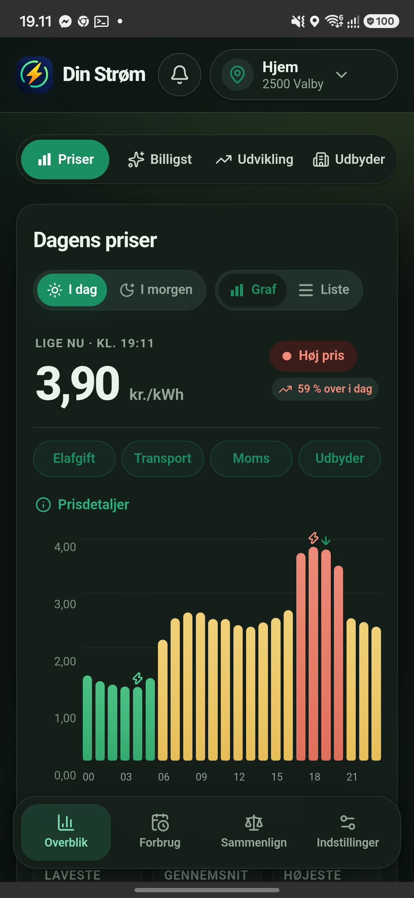
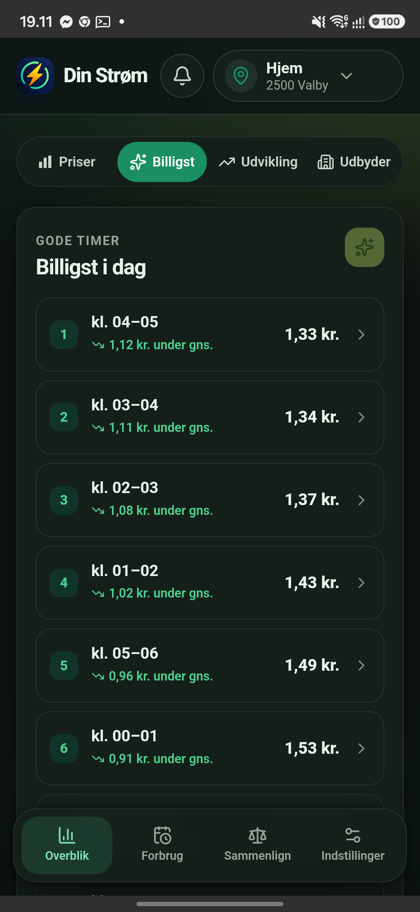
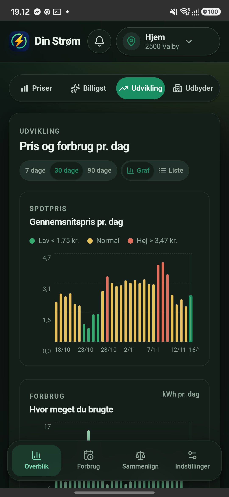
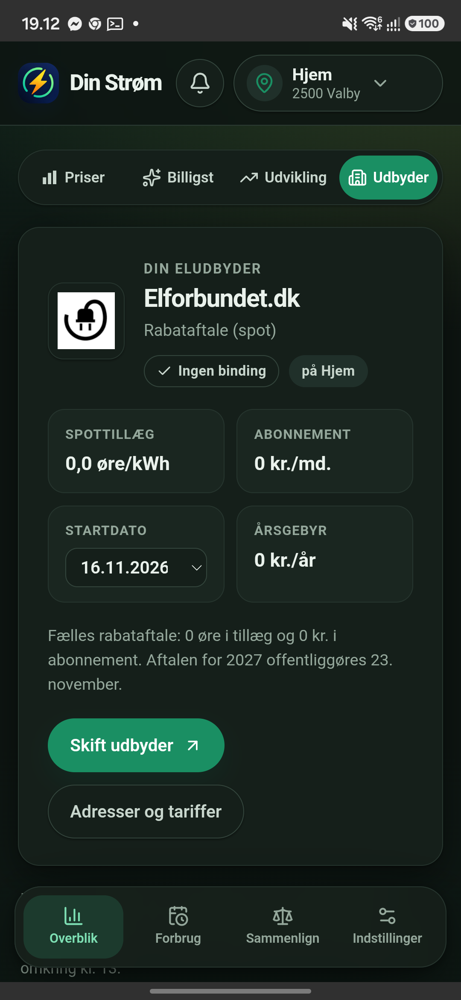
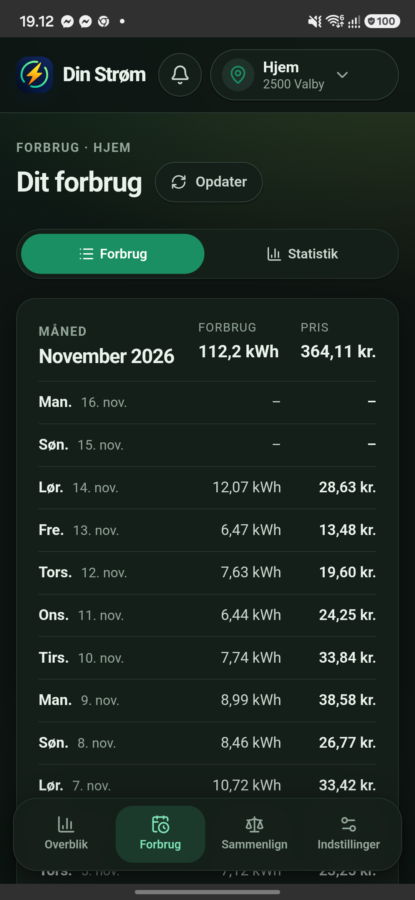
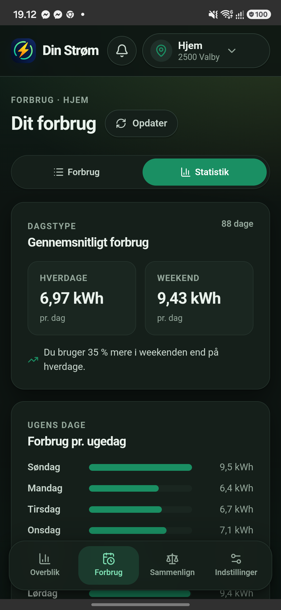
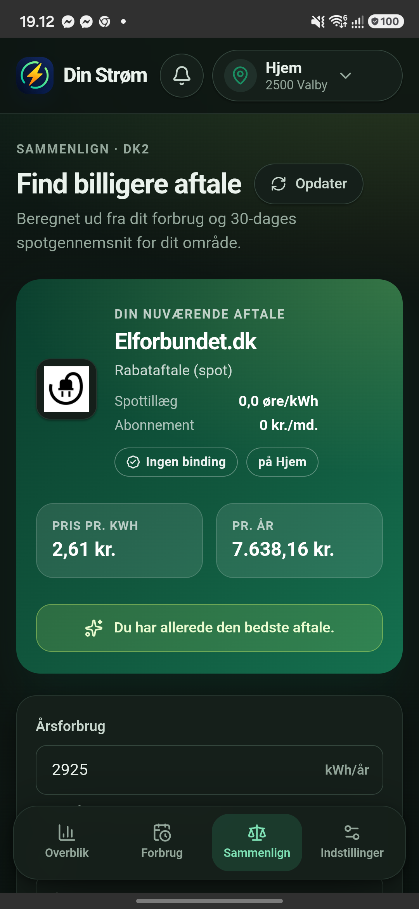
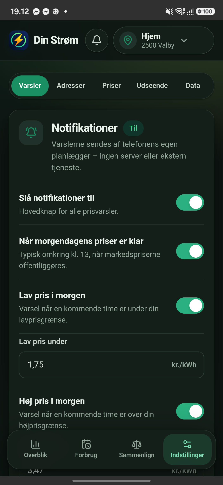

# Din Strøm

Android-app til danske elpriser og forbrug. Viser spotpriser time for time, dit faktiske forbrug fra Eloverblik og hvad strømmen koster med dine egne tariffer og din udbyder.

Appen kører helt uden server. Alt hentes direkte fra Energi Data Service og Eloverblik og gemmes kun på telefonen.

## Download

Hent nyeste APK under [Releases](https://github.com/aundal/din-strom/releases/latest) og installer den på telefonen. Du skal tillade installation fra ukendt kilde.

- Kræver Android 7.0 eller nyere
- Ingen konto, ingen server, ingen sporing

## Skærmbilleder

<table>
  <tr>
    <td align="center"> Priser</td>
    <td align="center"> Billigste timer</td>
    <td align="center"> Udvikling</td>
  </tr>
  <tr>
    <td align="center"> Din udbyder</td>
    <td align="center"> Forbrug</td>
    <td align="center"> Statistik</td>
  </tr>
  <tr>
    <td align="center"> Sammenlign udbydere</td>
    <td align="center"> Indstillinger</td>
    <td></td>
  </tr>
</table>

## Funktioner

**Priser**
- Spotpriser fra Energi Data Service, time for time og i 15-minutters opløsning
- Prisen i dag og i morgen, med farver for lav, normal og høj pris
- Slå elafgift, transport, moms og udbyderens tillæg til og fra
- Prisdetaljer der viser præcis hvad prisen består af

**Billigst**
- Dagens billigste timer rangeret, med besparelse i forhold til gennemsnittet

**Udvikling**
- Pris og forbrug pr. dag for de sidste 7, 30 eller 90 dage
- Graf eller liste

**Udbyder**
- Din nuværende aftale med spottillæg, abonnement og startdato
- Skift udbyder direkte fra appen

**Forbrug**
- Dit faktiske timeforbrug fra Eloverblik
- Månedsoversigt med forbrug og pris pr. dag
- Uendelig scroll tilbage til den ældste dag, Eloverblik har
- Tryk på en dag for at se timepriser, 15-minutters priser og forbrug

**Statistik**
- Gennemsnitligt forbrug på hverdage og i weekenden
- Forbrug pr. ugedag
- Dyreste og billigste dag, mest og mindst forbrug
- Samlet forbrug og pris, gennemsnitspris pr. kWh
- Billigste og dyreste måned

**Sammenlign**
- Sammenlign din aftale med udbydere i dit prisområde
- Pris pr. kWh og pr. år ud fra dit årsforbrug
- Se om du allerede har den bedste aftale

**Notifikationer**
- Besked når morgendagens priser er offentliggjort
- Varsel ved lav og høj pris i morgen
- Beskederne varierer og fortæller om det billigste tidsrum

**Andet**
- Mørkt og lyst tema
- Tariffer og netselskab findes automatisk ud fra din adresse

## Data og privatliv

Appen henter kun data fra:

- [Energi Data Service](https://www.energidataservice.dk/) – offentlige spotpriser
- [Eloverblik](https://eloverblik.dk/) – dit eget forbrug, hvis du forbinder det

Der er ingen mellemled, ingen database og ingen analytics. Dine adresser, dit forbrug og dit Eloverblik-token bliver liggende på telefonen.

## Ikke på Google Play

Appen distribueres kun som APK her på GitHub.
